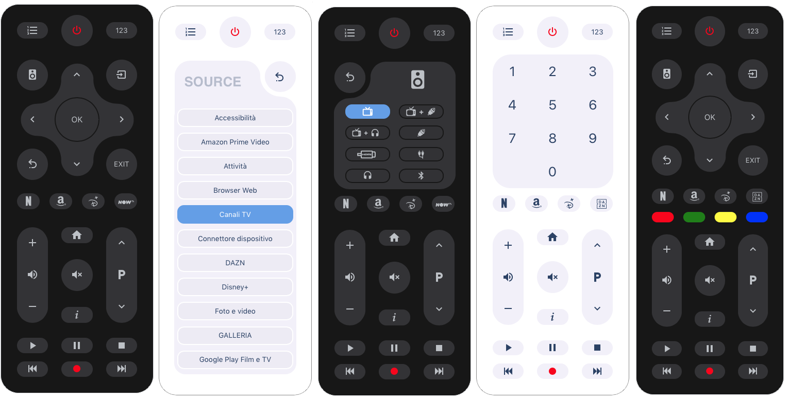
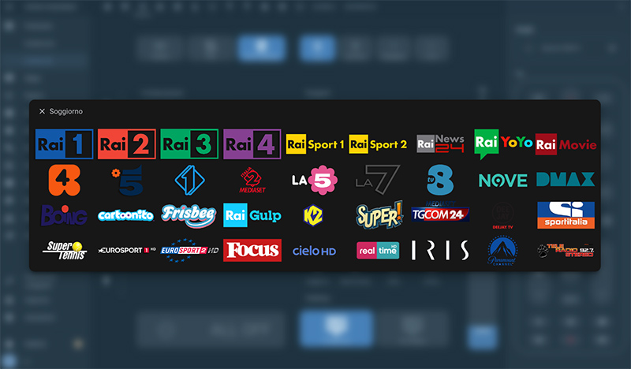
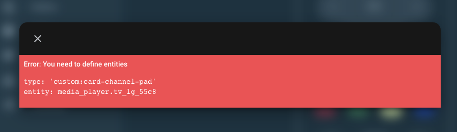
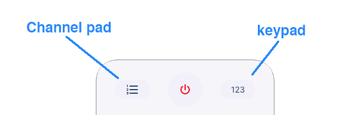

# LG-WebOS-Remote-Control
Remote Control for LG TV WebOS

[](https://github.com/hacs/integration)
[](https://www.buymeacoffee.com/madmicio)

the project is now curated and developed in collaboration with [Piotr Machowski](https://github.com/PiotrMachowski)






browser_mod is required for this channel panel (you can find it [here](https://github.com/thomasloven/hass-browser_mod))

custom card: "card-channel-pad" is required (you can find it [here](https://github.com/madmicio/channel-pad))

# New features

- [Customize button actions, icons and styles in the visual editor](#button-overrides).
- [Compose the TV title from entity, device and area names](#dynamic-tv-names).
- [Configure the Wake-on-LAN destination and port](#wake-on-lan-options).
- [Remove and save the complete A/V receiver association](#av-receiver-volume-control-options).


## hacs Card install
1. Find and install `LG WebOS Remote Control` plugin

2. Add a reference  inside your resources config:

  ```yaml
resources:
  - type: module
    url: /hacsfiles/LG-WebOS-Remote-Control/lg-remote-control.js
```


### Manual install

1. Download and copy `lg-remote-control.js` from (https://github.com/madmicio/LG-WebOS-Remote-Control/releases/latest) into your custom components  directory.

2. Add a reference `lg-remote-control.js` inside your resources config:

  ```yaml
  resources:
    - url: /local/"your_directory"/lg-remote-control.js
      type: module
  ```
# lovelace config: default view
```yaml
- type: 'custom:lg-remote-control'
  entity: media_player.tv_lg_55c8
  mac: xx:xx:xx:xx
```

### Main Options
| Name | Type | Default | Supported options | Description |
| -------------- | ----------- | ------------ | ------------------------------------------------ | --------------------------------------------------------------------------------------------------------------------------------------------------------------------------------------------------------------------------------------------------------------------------------------------------------------------------------------------- |
| `type` | string | **Required** | `custom:lg-remote-control` | Type of the card |
| `entity` | string | **Required** |  | tv entity |
| `name` | string / object / list | **Option** | | TV title; supports entity, device, area and floor name parts on Home Assistant 2026.4 and later (see below). |
| `mac` | string | **Option** |  | tv mac address (if not specified, you need to create an automation to perform the action to turn the TV on) |
| `broadcast_address` | string | **Option** | | Optional Wake-on-LAN destination IP or broadcast address, used with `mac`. |
| `broadcast_port` | number | **Option** | `9` | Optional Wake-on-LAN UDP port, used with `mac`. |
| `ampli_entity` | string | **Option** |  | your AV receiver entity (see option config) |
| `colors` | string | **Option** |  | list of color options |
| `channels` |  | **Option**|  | list of channel in popup |
| `sources` |  | **Option**|  | list of custom app. if not set, default apps will be displayed |
| `color_buttons` |  | **Option**| enable | display color buttons: RED GREEN YELLOW BLUE |
| `keys` | object | **Option** | | Per-button action, icon and style overrides (see Button overrides). |

### Wake-on-LAN options

When `mac` is configured, the card sends a Wake-on-LAN packet directly. Set the optional destination and UDP port in the card's YAML editor:

```yaml
type: custom:lg-remote-control
entity: media_player.lg_webos_smart_tv
mac: "00:11:22:33:44:55"
broadcast_address: 192.168.20.255
broadcast_port: 9
```

Leave these options unset to keep the usual Wake-on-LAN defaults. Without `mac`, the card continues to use the TV's `media_player.turn_on` action and any associated Home Assistant automation.

For a TV on another subnet or VLAN, the destination can be its IP address or its subnet's broadcast address. Delivery depends on the TV, routing, firewall and address resolution; directed broadcasts may require router configuration or a Wake-on-LAN relay. Setting an address alone does not guarantee that a sleeping TV can be reached.

### Dynamic TV names

On Home Assistant 2026.4 and later, `name` can be a string, one name item, or a list of name items. The visual editor offers Home Assistant's name picker when available:

```yaml
type: custom:lg-remote-control
entity: media_player.lg_webos_smart_tv
name:
  - type: area
  - type: text
    text: "-"
  - type: entity
```

Supported name parts are `entity`, `device`, `parent_device`, `area`, `floor`, and literal `text`. A plain string keeps its existing behavior. On older versions, composed names fall back to the entity's friendly name and the editor keeps its text field. Leave `name` unset to hide the title.

### Source Options
| Name | Type | Default | Supported options | Description |
| -------------- | ----------- | ------------ | ------------------------------------------------ | --------------------------------------------------------------------------------------------------------------------------------------------------------------------------------------------------------------------------------------------------------------------------------------------------------------------------------------------- |
| `icon` | string | **Required** | 'mdi:netflix'| url of the image to be displayed in the channel pad popup |
| `name` | string | **Required** | app name | you have to write the exact name of the app to launch. you can find the correct name in the state of your media_player entity under "source_list:" |
```yaml
sources:
  - icon: 'mdi:power'
    name: "Netflix"
  - icon: 'mdi:youtube'
    name: "YouTube"
```
**Note:**  `disney` `amazon` and `dazn` are special, icon you must enter them like this:
```yaml
  - icon: disney
    name: Disney+
  - icon: amazon
    name: Prime Video
  - icon: dazn
    name: Dazn
```
### Channels Options
| Name | Type | Default | Supported options | Description |
| -------------- | ----------- | ------------ | ------------------------------------------------ | --------------------------------------------------------------------------------------------------------------------------------------------------------------------------------------------------------------------------------------------------------------------------------------------------------------------------------------------- |
| `image` | url | **Required** | /local/your_dir/tv_logo/your_image.png | url of the image to be displayed in the channel pad popup |
| `number` | string | **Required** | number | TV channel number |
```yaml
channels:
  - image: /local/lg_remote/tv_logo/Rai 1 HD.png
    number: '501'
  - image: /local/lg_remote/tv_logo/Rai 2 HD.png
    number: '502'
  - image: /local/lg_remote/tv_logo/Rai 3 HD.png
    number: '503'
```

## Button overrides

Use the visual editor's **Overrides** section or add `keys` to the card's YAML configuration. You can change a button's action, its appearance, or both.

### Configure buttons in the visual editor

1. Open the dashboard editor and edit the LG remote card.
2. Expand **Overrides**, then select a button from **Select button to override...**.
3. Fill in the fields you want to change. For example, select **Volume Up**, enter `media_player.volume_up` as the service and your soundbar's entity as **Entity ID**.
4. Save the card and dashboard.

Use the delete icon beside an override to restore that button's original action, icon and style.

| Field / YAML option | How to use it |
| --- | --- |
| **Icon** / `icon` | Optional Material Design icon, such as `mdi:volume-plus`. Leave it empty to keep the original icon. |
| **Style** / `style` | Optional CSS, such as `"color: green;"`. It is appended to the button's existing inline styles. |
| **Service** / `service` | Optional Home Assistant service or script, such as `media_player.volume_up` or `script.movie_mode`. Leave it empty to keep the original action and its data. |
| **Entity ID** / `data.entity_id` | Target of a custom service. Configure any additional service data in YAML. |

When you set a custom service, it receives only the `data` you configure: TV-specific parameters from the original action are not added. A script that needs no data can omit `data`.

### Change only an icon or style

This changes PLAY's appearance while keeping its normal playback action:

```yaml
type: custom:lg-remote-control
entity: media_player.lg_webos_smart_tv
keys:
  PLAY:
    icon: mdi:play-circle
    style: "color: green;"
```

An empty override also keeps the original action. Icons and styles are supported on all listed keys, including all six media buttons.

### Make + and − control a soundbar

`VOLUME_UP` and `VOLUME_DOWN` refer to the actual **+** and **−** buttons. This example sends their commands to a soundbar and customizes their icons:

```yaml
type: custom:lg-remote-control
entity: media_player.lg_webos_smart_tv
keys:
  VOLUME_UP:
    service: media_player.volume_up
    data:
      entity_id: media_player.soundbar
    icon: mdi:volume-plus
    style: "color: green;"
  VOLUME_DOWN:
    service: media_player.volume_down
    data:
      entity_id: media_player.soundbar
    icon: mdi:volume-minus
```

Replace the example entity IDs with your own. A short press calls the configured service once; holding **+** or **−** repeats that same service until release.

### Run a script from a button

This makes RECORD run a script instead of its original recording action:

```yaml
type: custom:lg-remote-control
entity: media_player.lg_webos_smart_tv
keys:
  RECORD:
    service: script.movie_mode
    icon: mdi:movie-open
    style: "color: orange;"
```

The existing key spelling `FAST_FOWARD` is kept for compatibility. When `mac` is configured, power-on uses Wake-on-LAN directly; a `POWER` service override applies to power-on only when `mac` is absent.

See the [complete list of override keys and additional examples](Override_buttons.md).

## AV receiver volume control Options  

option dedicated to all those with problems controlling the volume of the AV Receiver through HDMI-cec commands.
if the ampli_entity item is configured, and when the sound output is set to external_arc (HDMI) or external_optical (optical output) then the remote control buttons will no longer act on the volume of the television, but on the volume of your receiver.

In the visual editor, click the trash icon beside **AV-Receiver config option**, then save the card and dashboard. This clears both the receiver family and its associated entity and restores the automatic volume target to the TV. Explicit button service overrides in `keys` keep their configured targets.


```yaml
type: 'custom:lg-remote-control'
entity: media_player.lg_webos_tv_oled55c8pla
mac: xx:xx:xx:xx:xx:xx
ampli_entity: media_player.marantz_sr6010
...
```

### power on/off Receiver
it would have been possible to implement automatic power on and choice of the input source of the Receiver when the sound output is set to external_arc (HDMI) or external_optical (optical output) and turn off the Receiver when any other sound output is set, but the card of home assistants do not work in background but only when rendered. for this and other reasons it is preferable to use a home assistant automation that manages the process, so the actions will also take place when operating with the physical remote control rather than with the home assistant card. 

Below is an example of code:

```yaml
alias: "tv_receiver"
trigger:
  - platform: template
    value_template: "{{ state_attr('media_player.lg_webos_tv_oled55c8pla', 'sound_output') == 'external_arc' }}"
    id: "external_arc"
  - platform: template
    value_template: "{{ state_attr('media_player.lg_webos_tv_oled55c8pla', 'sound_output') != 'external_arc' }}"
    id: "tv_speaker"
  - platform: state
    entity_id: media_player.lg_webos_tv_oled55c8pla
    from: 'off'
    to: 'on' 
    id: "tv_on"
  - platform: state
    entity_id: media_player.lg_webos_tv_oled55c8pla
    from: 'on'
    to: 'off' 
    id: "tv_off"
action:
  - choose:
    - conditions: "{{ trigger.id == 'tv_on' }}"
      sequence:
        - condition: template
          value_template: "{{ state_attr('media_player.lg_webos_tv_oled55c8pla', 'sound_output') == 'external_arc' }}"
        - service: media_player.turn_on
          target:
            entity_id: media_player.marantz_sr6010
        - wait_template: "{{ is_state('media_player.marantz_sr6010', 'on') }}"
        - service: media_player.select_source
          data:
            source: TV Audio
          target:
            entity_id: media_player.marantz_sr6010
    - conditions: "{{ trigger.id == 'external_arc'}}"
      sequence:
        - if: "{{ is_state('media_player.marantz_sr6010', 'on') }}"
          then:
            - service: media_player.select_source
              data:
                source: TV Audio
              target:
                entity_id: media_player.marantz_sr6010
          else:
            - service: media_player.turn_on
              target:
                entity_id: media_player.marantz_sr6010
            - wait_template: "{{ is_state('media_player.marantz_sr6010', 'on') }}"
            - service: media_player.select_source
              data:
                source: TV Audio
              target:
                entity_id: media_player.marantz_sr6010
    - conditions: "{{ trigger.id == 'tv_speaker' or trigger.id == 'tv_off' }}"
      sequence:
        - service: media_player.turn_off
          target:
            entity_id: media_player.marantz_sr6010
```

## MENU button
to display the "quick menu" (MENU function of WEBOS integration), long press, longer than 1 second, on the "HOME" button

## Color Management
color customization implemented through the section
```yaml
colors:
```


- buttons: set buttons  background color    - default: "#f2f0fa"
- texts: set buttons color                  - default: "var(--primary-text-color)"
- background: set remote background color   - default: "var(--primary-background-color)"
```yaml
colors:
  buttons: var(--deactive-background-button-color)
  texts: pink
  background: rgba(95,155,234)
```

**NOTE: option in "your-theme.yaml**
```yaml
#button
  deactive-background-button-color: "#f2f0fa"
```

### Colors Options
| Name | Type | Default | Supported options | Description |
| -------------- | ----------- | ------------ | ------------------------------------------------ | --------------------------------------------------------------------------------------------------------------------------------------------------------------------------------------------------------------------------------------------------------------------------------------------------------------------------------------------- |
| `buttons` | string | **Option** | color formats | buttons background-color |
| `texts` | string | **Option** | color formats | number and icon color |
| `background:` | string | **Option** | color formats | list of color options |
| `border:` | string | --app-header-text-color | color formats | remote border color |


### dimensions Options
| Name | Type | Default | Supported options | Description |
| -------------- | ----------- | ------------ | ------------------------------------------------ | --------------------------------------------------------------------------------------------------------------------------------------------------------------------------------------------------------------------------------------------------------------------------------------------------------------------------------------------- |
| `scale` |  | **Option**| number | scale factor; default 1 |
| `border_width` |  | **Option**| number | set remote border width; default 1px |

# Channel pad
in this version of the card there is no longer a "channel pad popup" with preset channels.
this is to give each user the ability to create his own list.

"channels" configuration is not mandatory. if "channels" is not configured the remote control will work normally but you will not be able to use the channel pad.
pressing the button on the remote control you will receive this message.


# New Features Config
in this new version we have implemented some new features:
1. customizable and incremental app button

    option: **sources:** ( if you do not configure this option, the remote control will display the default apps)

2. customizable channel pad

    option: **channels:** ( if you do not configure this option, on button click you receive an error message)

3. customizable scale:

    option: **scale:** ( this option reduces or enlarges the size of the remote control. we are testing this option )

# lovelace config: custom view
```yaml
- type: 'custom:lg-remote-control'
  entity: media_player.tv_lg_55c8
  mac: xx:xx:xx:xx
  sources:
    - name: Netflix
      icon: 'mdi:netflix'
    - name: Disney+
      icon: disney
    - name: Dazn
      icon: dazn
    - name: YouTube
      icon: 'mdi:youtube-tv'
    - name: HDMI 1
      icon: 'mdi:video-input-hdmi'
    - name: HDMI 2
      icon: 'mdi:video-input-hdmi'
  channels:
    - image: /local/images/tv_logo/channel_1.png
      number: '1'
    - image: /local/images/tv_logo/channel_2.png
      number: '1'

   
```
**note: disney and danz are special icon. so you you must enter it as in the example**

  ## dimnensions option:
  
  the remote control supports the scale option to adjust its size
```yaml
- type: 'custom:lg-remote-control'
  entity: media_player.tv_lg_55c8
  mac: xx:xx:xx:xx
  dimensions:
    scale: 0.98
    border_width: 3px
```
  
  ## Install Tv Logo
  
  1. download tv_logo
  2. directory put the images file where you prefer (we suggest: www / images / tv_logo)
  3. calls the image in the configuration as in the example 
```yaml
image: /local/your_directory/your_file.png
```
**new_tv logo**
at this moment only tv logo of italian tv are available.
users who produce other logos are invited to share them, so we could have a complete and international library
**new logo spec**
height: 268px
width: 171px
background: transparent
image must have 10px margin like this example:


## Popup Buttons



<a href="https://www.buymeacoffee.com/madmicio" target="_blank"></a>

